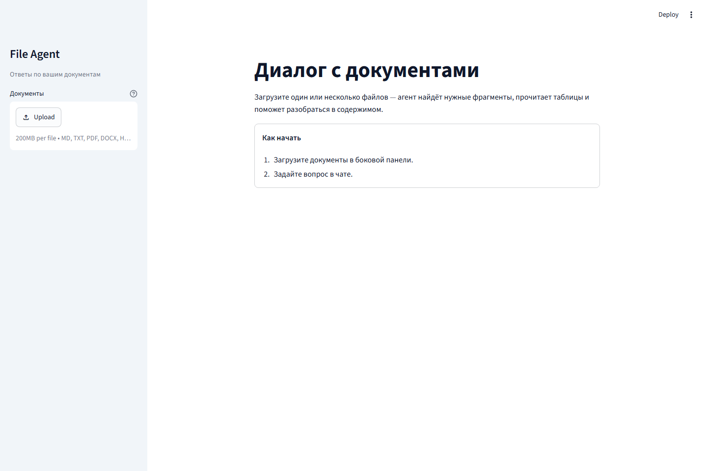

# File Agent

**Ask questions across documents. Follow the evidence.**

[](https://github.com/MusiJusi/file-agent-showcase/actions/workflows/ci.yml)


A document QA application with a LangGraph tool agent, structure-aware parsing,
hybrid retrieval, and answers backed by source passages. Upload files to a
Streamlit chat, ask a question, and inspect the evidence used in the answer.

[Quick start](#quick-start) · [Architecture](docs/architecture.md) ·
[Evaluation](docs/evaluation.md) · [Examples](examples/README.md) ·
[Documentation](docs/README.md)


## What it does

| Capability | Implementation |
| --- | --- |
| Understand document structure | Dedicated parsers for PDF, DOCX, PPTX, XLSX, HTML, Markdown, and TXT |
| Find relevant evidence | BM25 + Qwen3 dense embeddings, reciprocal rank fusion, optional Qwen3 reranking |
| Answer multi-step questions | A bounded LangGraph loop with 15 read-only tools and compact conversation memory |
| Work with tables precisely | Exact row lookup, full-table aggregation, column comparison, and decimal arithmetic |
| Read visual content | Per-page PDF OCR, figure descriptions, and on-demand PDF visual analysis |
| Keep answers inspectable | File, page, slide, and sheet metadata propagated to answer sources |
| Run reproducible experiments | Hugging Face and DocBench runners, checkpoints, manifests, and an LLM judge |

Two execution modes share the same ingestion and retrieval layers:
`tool_agent` selects document tools as needed; `standard` retrieves once and
generates an answer. The example configuration selects the agent.

<details>
<summary>Application preview — the actual Streamlit welcome screen</summary>



Captured locally with the checked-in theme. No model output is simulated.

</details>

## Quick start

Python **3.12 is recommended**. Install [uv](https://docs.astral.sh/uv/), then:

```bash
git clone https://github.com/MusiJusi/file-agent-showcase.git
cd file-agent-showcase
uv sync --python 3.12 --frozen
```

Create a local configuration:

```bash
# macOS / Linux
cp .env.example .env
```

```powershell
# Windows PowerShell
Copy-Item .env.example .env
```

The example uses an existing OpenAI-compatible endpoint serving Qwen3.5-27B.
Adjust these values to match your server:

```dotenv
LLM_BACKEND=local
LOCAL_LLM_BASE_URL=http://127.0.0.1:18000/v1
LOCAL_LLM_MODEL=Qwen/Qwen3.5-27B
RAG_MODE=tool_agent
```

Then start the application:

```bash
uv run streamlit run app.py
```

Open **http://localhost:8501**, upload the fictional documents in
[`examples/`](examples/README.md), and try:

- “What was North's revenue growth from Q1 to Q2?”
- “Which regions exceeded their quarterly target?”
- “What service credit applies if availability is 99.3%?”

The UI is in Russian; questions and answers can use the document's language.
See [endpoint configuration](docs/local_inference.md) for native tool-calling
requirements, cloud backends, and visual support.

The first ingestion may download embedding, reranking, OCR, and layout models.
Their inference runs locally; answer generation uses your configured endpoint.
For text-only use, set `VLM_BACKEND=off`; set `RERANKER_MODEL=` to disable
reranking. These choices change quality and resource use.

## Evaluation snapshot

An archived evaluation of **125 selected questions** with DeepSeek V4 Flash and
evaluator version 2 produced:

| Faithfulness | Answer correctness | Answer relevancy | Context precision | Context recall |
| ---: | ---: | ---: | ---: | ---: |
| 0.8769 | 0.6141 | 0.8212 | 0.7493 | 0.8413 |

These are mean LLM-judge scores on a 0–1 scale, not percentages of correct answers.
Two of the original 127 questions were excluded for suspected reference-label
errors. This is an archived answer-artifact result, not a fresh benchmark of every
subsequent code change. The [evaluation note](docs/evaluation.md) records the
protocol, exclusions, artifact fingerprint, and limitations; the
[sanitized summary](docs/results/agent-v6-eval125.json) contains the source values.

## Explore the code

```text
app.py                      Streamlit entry point
src/file_agent/
  agent_tools/              Search, navigation, tables, statistics, vision, prompts
  benchmarks/               Hugging Face and DocBench generation
  parsers/                  Format-aware document ingestion
  llm/                      Answering-model interface and adapters
  vlm/                      Visual-model interface and adapters
  document.py               Shared Document / Block representation
  pipeline.py               Parser selection and ingestion policy
  chunking.py               Token-budgeted, structure-aware chunks
  lancedb_retriever.py       Hybrid retrieval and reranking
  rag.py / rag_core.py       Public orchestration and shared response primitives
  rag_graph.py              Ingestion, QA, and tool-agent graphs
eval_pipeline/              Independent LLM-as-judge evaluator
tests/                      Tests grouped by subsystem
docs/                       Architecture, guides, and research notes
examples/                   Fictional documents and verifiable questions
```

The original `generate_hf_dataset.py` / `generate_docbench.py` commands and
`file_agent.hf_*` / `file_agent.docbench_*` imports remain compatible.
New code uses `file_agent.benchmarks`.
See [architecture](docs/architecture.md) for the contracts between layers.

## Development

```bash
uv run pytest
uv run ruff check .
uv run ruff format --check .

# The evaluator has its own dependency environment.
cd eval_pipeline
uv sync --python 3.12 --frozen
uv run pytest tests
```

Tests fake LLM/VLM requests and use small, generated document fixtures.
[CI](.github/workflows/ci.yml) checks the application and evaluator separately.
See [CONTRIBUTING.md](CONTRIBUTING.md) for the development workflow.

[Docker and tracing](docs/deployment.md) are available for containerized use and
OpenTelemetry/Jaeger inspection.

## Project background

This is a portfolio edition of a team document-QA project. The shared foundation
provides document parsing, chunking, and retrieval. This edition presents the
LangGraph agent, evidence-aware tools, generation runners, and evaluation
improvements developed on top of that foundation. See
[project background](docs/project_background.md) for scope and attribution.
