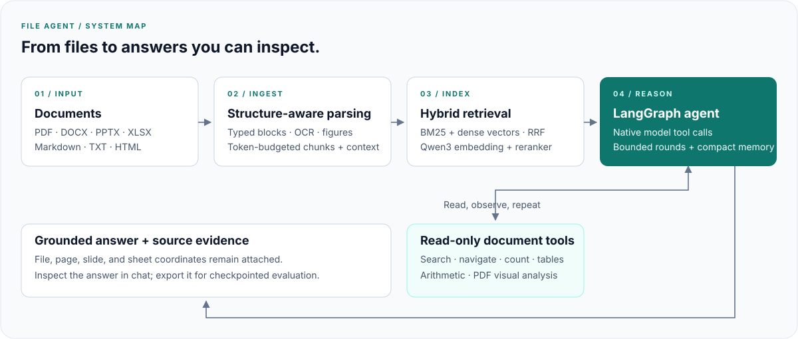
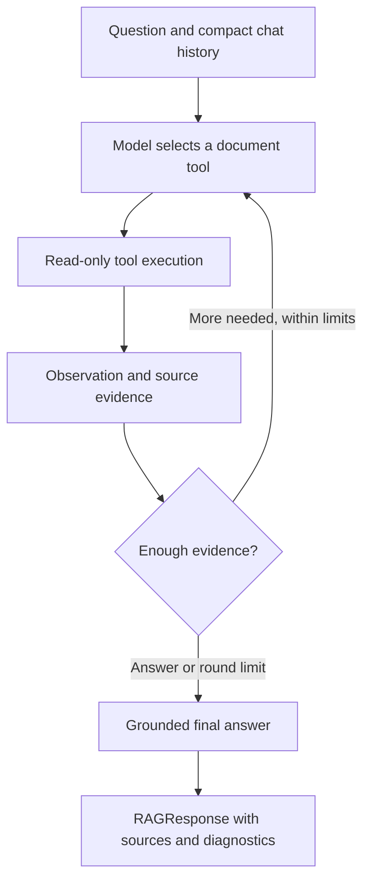

# Architecture

File Agent keeps ingestion, retrieval, tool execution, and model integration
separate. Standard RAG and the agent share document objects and source metadata.

## Data flow and contracts

| Stage | Main modules | Contract |
| --- | --- | --- |
| Parse | `pipeline.py`, `parsers/` | A `Document` contains typed `Block` objects and source coordinates |
| Chunk | `chunking.py` | Retrieval text fits the encoder; `metadata["context"]` carries a larger answer passage |
| Retrieve | `retrieval.py`, `lancedb_retriever.py` | `Retriever` returns scored `SearchResult` objects |
| Answer | `qa.py`, `rag.py`, `rag_graph.py` | `RAGResponse` contains the answer, evidence, and diagnostics |
| Call a model | `llm/`, `vlm/` | Clients isolate provider configuration and transport |

Embedded text is deliberately smaller than the passage the model reads.
Small-to-big retrieval preserves ranking precision and the surrounding section.
Tables retain headers across splits; row records make exact lookups searchable.

## Agent execution

The graph bounds tool rounds and model-facing context. Tool traces belong to the
current turn; compact user/final-answer pairs support follow-up questions.
Evidence is propagated to `RAGResponse.sources`. Arithmetic does not substitute
for reading source values.

## Agent tools

`agent_tools/__init__.py` is the public registry. All 15 tool names, their order,
and the original public imports are preserved.

| Module | Responsibility |
| --- | --- |
| `search.py` | Hybrid search and expansion of source passages |
| `navigation.py` | File listing, outlines, whole-document and location reads |
| `statistics.py` | Metadata, content statistics, literal occurrence counts |
| `tables.py` | Exact lookup, aggregation, cross-table comparison, arithmetic |
| `visual.py` | PDF figure/page analysis and image-size limits |
| `prompts.py` | Grounding, visual, and round-limit instructions |
| `context.py` | Injected model, retriever, documents, and assets |
| `common.py` | Source metadata, evidence propagation, rendering, pagination |
| `limits.py` | Bounds shared by tools |

The split changes ownership and discoverability, not prompts or tool behavior.

## Benchmark and evaluation boundary

`benchmarks/hf/` and `benchmarks/docbench/` own dataset loading, resumable
generation, and exports. Root CLI entry points remain available. Thin import
aliases preserve `file_agent.hf_*` and `file_agent.docbench_*`, including
monkeypatching through those old paths.

`eval_pipeline/` is independent, with its own lockfile and environment. It accepts
generated answers and evidence rather than importing the application.
Generation and evaluation can be resumed and audited separately.

## Limitations

- XLSX reads cached formula values and does not calculate Excel formulas.
- Exact tools operate on parsed content; they cannot recover missing extraction.
- Visual answers and LLM synthesis can still be wrong.
- Models can require an initial download even when inference is local.
- The retriever is in-memory; this is not a multi-tenant hosted service.
